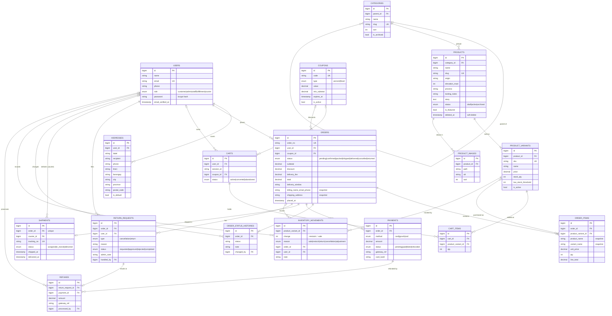

# AMIHAN: Entity Relationship Diagram

Render it in VS Code (Markdown Preview with a Mermaid extension) or paste the block into https://mermaid.live and export a PNG for the slides.

- **PK** marks the primary key, and **FK** marks a foreign key.
- Crow's-foot notation:
  - `||` exactly one
  - `o|` zero or one
  - `|{` one or many
  - `o{` zero or many

## Talking points

- **Price and stock live on the variant, not the product.** "Atok Highland" is sold as 250 g and as 500 g, and each size has its own price, stock and SKU.
- **Orders snapshot names, prices and addresses.** If a price changes or a customer moves, past orders still show exactly what was bought.
- **The cart is a table, not just session data.** That is how it survives page changes and merges into the account at login. It also lets the admin reports measure conversion (carts that became orders) and abandonment (carts left idle).
- **`inventory_movements` is a ledger.** Every sale, restock, return and manual adjustment is a row, so stock levels can always be explained.
- **Return requests and refunds are separate tables.** A request can be approved or declined. Only an approved request that had a paid payment produces a refund row.
- **Roles live on `users.role`.** The `EnsureRole` middleware and Laravel Gates read it to decide what each person can see and do.
